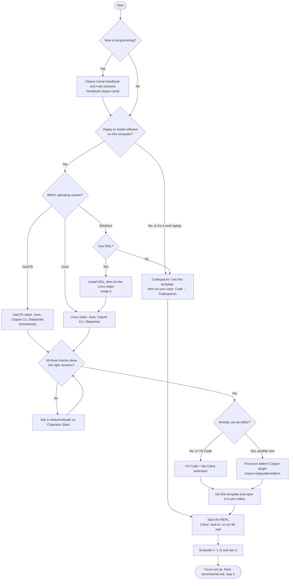

<!-- L3 (Human-verified): AI-drafted onboarding flowchart; Jordan Miller verified its install commands and claims against clojure.org's Install Clojure guide and the Babashka README on 2026-11-24. Remove this line when endorsed (L4). -->

# Set up Clojure: a flowchart

Brand new to Clojure? Follow the arrows. You'll finish with a REPL running this template, ready for the [tutorial](tutorial.md).

**What you need:**
- **Java** and the **Clojure CLI**.
- **Babashka.** This template's README calls it optional, but the tutorial uses its `bb` commands, and `bb new-day` has no plain-`clojure` equivalent. Install it too.
- **An editor.**

If you'd rather install nothing, use [Codespaces](https://docs.github.com/en/codespaces/overview) ([step 2](#2-install-or-not)).

Each install command here comes from clojure.org's [Install Clojure](https://clojure.org/guides/install_clojure) guide or the [Babashka README](https://github.com/babashka/babashka#installation). If a command fails, those pages are the authority. These commands were compared with those pages on 2026-11-24, not run on every system.



The same path as steps, with the commands:

## 1. New to programming?

Start with [Clojure Camp](https://handbook.clojure.camp): its handbook, and its [mob sessions](https://github.com/clojure-camp/wiki/blob/main/initiatives/mob-sessions.md), which run in the [Clojure Camp Discord](https://discord.clojure.camp). Then come back here.

## 2. Install, or not?

**Don't want to install anything, or on a work laptop?** Use [Codespaces](https://docs.github.com/en/codespaces/overview), if your employer or school allows it.
1. Click **Use this template** on GitHub to make your own copy.
2. On your copy, choose **Code → Codespaces → Create codespace**. It installs Java, the Clojure CLI, Babashka and [Calva](https://calva.io) for you.
3. Then go to [step 6](#6-start-the-repl) and start the REPL.

Otherwise, go to the steps for your operating system.

## 3. Install Java, the Clojure CLI and Babashka

Prefer a video? The Clojure team's [Zero to REPL](https://clojure.org/news/2026/03/30/zero_to_repl) videos on [ClojureTV](https://www.youtube.com/@ClojureTV) walk through this for your system. They cover Java, the Clojure CLI and Calva, but not Babashka:
- [macOS](https://www.youtube.com/watch?v=huGyv5yLIM8)
- [Linux](https://www.youtube.com/watch?v=544xOAIg3y0)
- [Windows (WSL)](https://www.youtube.com/watch?v=TQgzA3QLz-k)

### macOS

These steps use [Homebrew](https://brew.sh/), clojure.org's route on macOS. If `brew --version` doesn't work, install Homebrew from that page first.

```sh
# Java: only if `java --version` doesn't already show 21 or newer.
# clojure.org recommends Temurin 25 if you don't have Java.
brew install --cask temurin@25

# Clojure CLI. Trusting the tap is a one-time step.
brew trust clojure/tools
brew install clojure/tools/clojure

# Babashka
brew install borkdude/brew/babashka
```

- **Java:** the Temurin installer may ask for your password. If `java --version` doesn't show Temurin 25 afterwards, the install guide's [Java section](https://clojure.org/guides/install_clojure#java) explains how to put it on your `PATH`.
- **Babashka:** if Homebrew warns `Skipping babashka: tap formula is not trusted`, run `brew trust borkdude/brew`, then install again.

### Linux

1. **Java.** Install Temurin 25 from [Adoptium's Temurin downloads](https://adoptium.net/temurin/releases/), or use your distribution's OpenJDK package, version 21 or newer. Clojure works with ["any Java distribution"](https://clojure.org/guides/install_clojure#java), and this template's README asks for Java 21 or newer. Afterwards, check that `java --version` works in a new terminal.
2. **Clojure CLI.** It needs `bash`, `curl` and `rlwrap`; install them with your package manager if they're missing. Then download the installer into a temporary folder and run it:

   ```sh
   cd "$(mktemp -d)"
   curl -L -O https://github.com/clojure/brew-install/releases/latest/download/linux-install.sh
   chmod +x linux-install.sh
   sudo ./linux-install.sh
   ```

   It uses `sudo` because it installs into `/usr/local`: `/usr/local/bin/clj`, `/usr/local/bin/clojure` and `/usr/local/lib/clojure`. You can read the script first with `less linux-install.sh`.
3. **Babashka.** In the same temporary folder:

   ```sh
   curl -sLO https://raw.githubusercontent.com/babashka/babashka/master/install
   chmod +x install
   ./install
   ```

   - It installs into `/usr/local/bin`.
   - If you get a permission error, run `sudo ./install`, or `./install --dir ~/.local/bin` to install somewhere you own.
   - If `bb --version` then says "command not found", that folder isn't on your `PATH`.
   - If you use Homebrew on Linux, `brew install borkdude/brew/babashka` works too.

### Windows

- **With WSL (Windows Subsystem for Linux):** this is clojure.org's recommendation. [Install WSL](https://learn.microsoft.com/windows/wsl/install), open your Linux shell, and follow the Linux steps there. In [clojure.org's words](https://clojure.org/guides/install_clojure#_windows_subsystem_for_linux_wsl), WSL "will provide the closest match for most existing Clojure tutorials and documentation".
- **Without WSL:** use Codespaces ([step 2](#2-install-or-not)).
  - Other options: install Java, then [clj-msi](https://github.com/casselc/clj-msi) for the Clojure CLI (clojure.org's Windows installer).
  - For Babashka, see the Windows section of the [Babashka README](https://github.com/babashka/babashka#windows). It uses scoop, which you install by running a script from get.scoop.sh.

## 4. Check all three

Run these in a new terminal:

```sh
java --version     # should show 21 or newer
clojure --version  # should show Clojure CLI version 1.12 or newer
bb --version       # should print a version
```

- If `java --version` says "Unrecognized option", your Java is older than 9: install a newer one.
- If any check fails, ask in `#adventofcode` on [Clojurians Slack](https://clojurians.net) and paste the error.

## 5. Pick an editor

- **No editor yet, or you use VS Code:** install [VS Code](https://code.visualstudio.com/), then the [Calva](https://calva.io) extension. In VS Code's Extensions view, search for "Calva".
- **You already use another editor:** find a Clojure plugin for it on clojure.org's [editors page](https://clojure.org/guides/editors).

## 6. Start the REPL

If you're not in Codespaces, get this template: click **Use this template** on GitHub, or clone it. Then open the folder in your editor.

- **In Calva:** open the Command Palette and run **Calva: Start a Project REPL and Connect (aka Jack-In)**. Choose `deps.edn`.
- **In a terminal:** run `bb repl`, then use your editor's "connect to a running REPL" command.

The first start downloads the template's libraries, so it can take a minute or more.

Type `(+ 1 2)` in any `.clj` file and evaluate it. In Calva, put the cursor after the `)` and press <kbd>Ctrl</kbd>+<kbd>Enter</kbd>. You should see `3`.

**You're set up.** Continue with the [tutorial, from step 3](tutorial.md#3-read-the-example-day).

## Using an AI agent?

If you use an AI coding agent, it can do steps 3–5 with you and explain each one as it goes. Point it at the [setup-clojure skill](../ai/skills/setup-clojure/SKILL.md) (`ai/skills/setup-clojure/SKILL.md`). It's optional; everything above works without AI.

## Where these commands come from

- **Java and the Clojure CLI:** clojure.org, [Install Clojure](https://clojure.org/guides/install_clojure).
- **Babashka:** the [Babashka README](https://github.com/babashka/babashka#installation).
- **The videos:** [Zero to REPL](https://clojure.org/news/2026/03/30/zero_to_repl), by the Clojure team, on [ClojureTV](https://www.youtube.com/@ClojureTV).
- **Codespaces:** GitHub's [Codespaces overview](https://docs.github.com/en/codespaces/overview).
- **Editors:** clojure.org, [Editors](https://clojure.org/guides/editors).
