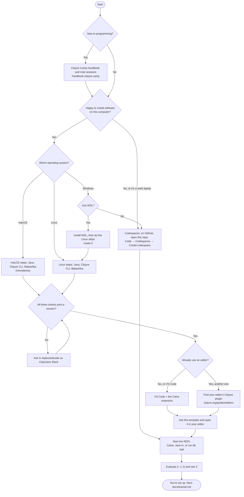

<!-- DRAFT: AI-drafted onboarding flowchart; pending Jordan's review. Remove this line when endorsed. -->

# Set up Clojure: a flowchart

Brand new to Clojure? Follow the arrows. You'll finish with a REPL running this template, ready for the [tutorial](tutorial.md).

You need three things: **Java**, the **Clojure CLI**, and **Babashka**. You also need an editor. If you'd rather install nothing, use Codespaces; it's the first branch below.

Each install command here comes from that tool's own install page, linked in [Where these commands come from](#where-these-commands-come-from). If a command fails, check that page first, since it is kept up to date and this page isn't. Commands checked 2026-11-24.



The same path as steps, with the commands:

## 1. New to programming?

Start with [Clojure Camp](https://clojure.camp): its [handbook](https://handbook.clojure.camp) and its mob sessions in the [Discord](https://discord.clojure.camp). Then come back here.

## 2. Install, or not?

**Don't want to install anything, or on a work laptop?** Use Codespaces. On GitHub, open this repository and choose **Code → Codespaces → Create codespace**. It installs Java, the Clojure CLI, Babashka and Calva for you. Skip to [step 6](#6-start-the-repl).

Otherwise, go to the steps for your operating system.

## 3. Install Java, the Clojure CLI and Babashka

Prefer a video? The Clojure team's **Zero to REPL** walks through this for your system. It covers Java, the Clojure CLI and Calva, but not Babashka:
- [macOS](https://www.youtube.com/watch?v=huGyv5yLIM8)
- [Linux](https://www.youtube.com/watch?v=544xOAIg3y0)
- [Windows (WSL)](https://www.youtube.com/watch?v=TQgzA3QLz-k)

### macOS

You need [Homebrew](https://brew.sh/). If `brew --version` doesn't work, install it from that page first.

```sh
# Java (Temurin 25, as clojure.org recommends)
brew install --cask temurin@25

# Clojure CLI. Trusting the tap is a one-time step.
brew trust clojure/tools
brew install clojure/tools/clojure

# Babashka
brew install borkdude/brew/babashka
```

If `java --version` doesn't show Temurin 25 afterwards, the [install guide](https://clojure.org/guides/install_clojure) explains how to put it on your `PATH`.

### Linux

1. **Java.** Install Temurin 25 from [adoptium.net](https://adoptium.net/), or use your distribution's OpenJDK package, version 21 or newer. Clojure works with "any Java distribution". This template needs Java 21 or newer.
2. **Clojure CLI.** It needs `bash`, `curl` and `rlwrap`; install them with your package manager if they're missing. Then:

   ```sh
   curl -L -O https://github.com/clojure/brew-install/releases/latest/download/linux-install.sh
   chmod +x linux-install.sh
   sudo ./linux-install.sh
   ```

3. **Babashka.** Download the installer, look at it if you like, then run it:

   ```sh
   curl -sLO https://raw.githubusercontent.com/babashka/babashka/master/install
   chmod +x install
   ./install
   ```

   It installs into `/usr/local/bin`. If you get a permission error, run `sudo ./install`, or `./install --dir ~/bin` to install somewhere you own.

   If you use Homebrew on Linux, `brew install borkdude/brew/babashka` works too.

### Windows

- **With WSL (recommended by clojure.org):** [install WSL](https://learn.microsoft.com/en-us/windows/wsl/install), open your Linux shell, and follow the Linux steps there. clojure.org's reason: it "will provide the closest match for most existing Clojure tutorials and documentation".
- **Without WSL:** use Codespaces ([step 2](#2-install-or-not)). Advanced alternatives are [clj-msi](https://github.com/casselc/clj-msi) for the Clojure CLI, and [scoop](https://scoop.sh/) for Babashka (`scoop install babashka`, after adding the buckets shown in the [Babashka README](https://github.com/babashka/babashka#windows)).

## 4. Check all three

Run these in a new terminal. Each should print a version:

```sh
java --version
clojure -M -e '(clojure-version)'
bb --version
```

The first `clojure` run downloads some files, so give it a minute. If any of the three fails, ask in `#adventofcode` on [Clojurians Slack](https://clojurians.net) and paste the error.

## 5. Pick an editor

- **No editor yet, or you use VS Code:** install [VS Code](https://code.visualstudio.com/), then the [Calva](https://calva.io) extension. In VS Code's Extensions view, search for "Calva".
- **You already use another editor:** find its Clojure plugin on clojure.org's [editors page](https://clojure.org/guides/editors), and use the one it lists for your editor.

## 6. Start the REPL

Get this template: use **Use this template** on GitHub, or clone it. Then open the folder in your editor.

- **In Calva:** open the Command Palette and run **Calva: Start a Project REPL and Connect (aka Jack-In)**. Choose `deps.edn`.
- **In a terminal:** run `bb repl`, then use your editor's "connect to a running REPL" command.

Type `(+ 1 2)` in any `.clj` file and evaluate it. In Calva, put the cursor after the `)` and press <kbd>Ctrl</kbd>+<kbd>Enter</kbd>. You should see `3`.

**You're set up.** Continue with the [tutorial](tutorial.md), from step 3.

## Using an AI agent?

If you use an AI coding agent, it can do steps 3–5 for you and explain each one as it goes. See [`ai/skills/setup-clojure/SKILL.md`](../ai/skills/setup-clojure/SKILL.md). That is optional; everything above works without AI.

## Where these commands come from

- **Java and the Clojure CLI:** clojure.org, [Install Clojure](https://clojure.org/guides/install_clojure).
- **Babashka:** the [Babashka README](https://github.com/babashka/babashka#installation).
- **The videos:** [Zero to REPL](https://clojure.org/news/2026/03/30/zero_to_repl), by the Clojure team, on ClojureTV.
- **Editors:** clojure.org, [Editors](https://clojure.org/guides/editors).
